  

  I build backends in <b>Java and Spring Boot</b>, frontends in <b>Next.js</b>, and run them on <b>AWS, Hetzner and Cloudflare</b>. 
  Two and a half years across logistics ERP, insurance, healthcare and IoT, from the database schema to the deploy.

  <a href="https://www.linkedin.com/in/adwait-gawade/">LinkedIn</a>
  &nbsp;·&nbsp;
  Mumbai, India

 

  

  

 

  B.Tech in Information Technology, University of Mumbai · German, Goethe-Institut B1

